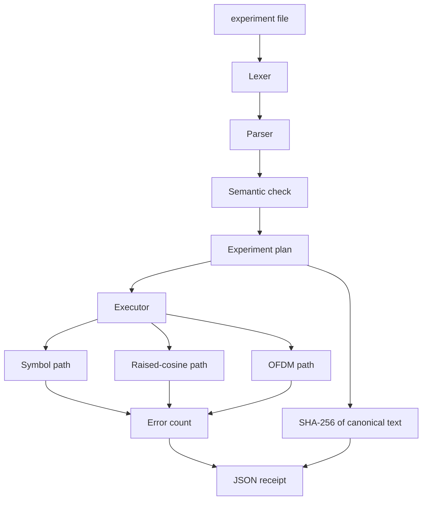
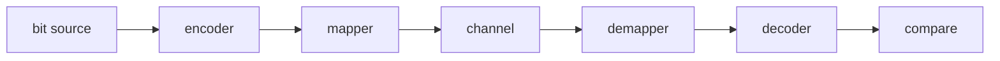

# Architecture

Quartz is a laboratory, not a radio driver. A trial is a program. The program
lowers to a plan. The plan names a modem, a code, a channel, and a seed. The
executor runs that plan and writes a receipt. The same source and the same
binary produce the same receipt.

## Layers

The symbol path is the one a textbook formula is allowed to grade. One sample
is one symbol, the pulse is rectangular, and the noise variance comes from
Eb/N0, the bits per symbol, and the nominal code rate. Raised cosine and OFDM
are waveform paths. A silent channel on those paths must return the payload.
They are not graded against an erfc curve, because the sample-rate noise
bandwidth is a different question.

## What is shared

| Piece | Used by |
|---|---|
| Complex baseband type | Constellations, FFT, MIMO, channels |
| Galois field | Reed-Solomon, BCH |
| Berlekamp-Massey and Chien search | Reed-Solomon and binary BCH |
| Convolutional encoder | Viterbi and BCJR |
| Radix-2 FFT | OFDM, periodogram, Bluestein |
| xoshiro256** | Every noise draw and every bit source |
| CRC-32 | Frames and PNG chunks |
| SHA-256 | Receipts |

## Clocks

Sample rates that are integers become a reduced rational. 44100 Hz into
48000 Hz is 160/147, not a truncated double. The NCO keeps phase in cycles,
so a quarter-cycle tone is a walk around the four axes and a frequency is a
fraction of the sample rate.

## Graphs

A phase-locked loop holds its feedback inside one node. The experiment graph
is a DAG. `quartz.sim.graph` rejects a back edge. That constraint is what
makes a schedule hashable: there is one topological order for a given edge
list, up to the order in which ready nodes were inserted.

## Numeric paths

Most of the laboratory is double-precision baseband. A Q15 FIR sits beside
the floating FIR and is checked with an impulse. Fixed point is there to
count rounding, not to chase cycles on a bare-metal DSP. Fresh `double`
storage in D is NaN, so every accumulator and every matrix is zeroed on
purpose. A NaN integrator is how a phase-locked loop silently dies.

## Receipts

`plan.canonical()` writes one key per line in a fixed order. SHA-256 of that
text is `plan_sha256` in the JSON receipt. The seed, the information-bit
count, and the error count sit next to it. A second run with the same file
reprints the digest.
