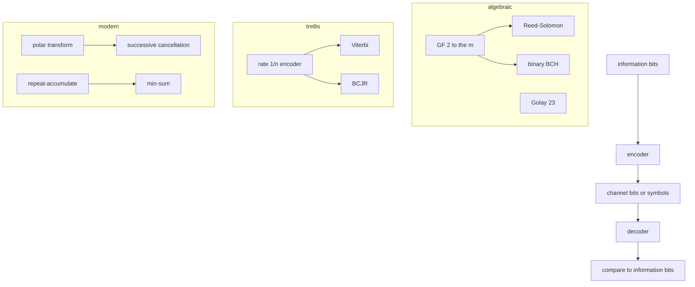

# Coding

The codes are linear, small enough to test by exhaustion where that is
cheap, and wired into the experiment executor where the block length is
regular.

## Hamming

Parity bits sit at powers of two, counting positions from 1. The syndrome is
the index of the bit to flip. Every one of the 16 Hamming(7, 4) messages is
corrected after every single flip. The extended code adds an overall parity
bit and flags a double error.

## Golay

The binary Golay code of length 23 is the cyclic code generated by
`0xC75`. All 4096 codewords are enumerated. The minimum distance is 7. The
syndrome table has 2048 entries, one for every pattern of weight at most 3,
which is the perfect-code count `1 + 23 + C(23,2) + C(23,3)`.

## Reed-Solomon

The generator has roots `alpha^b, ..., alpha^{b+2t-1}`. A codeword is
systematic: low coefficients are parity, high coefficients are the message.
Decoding is Berlekamp-Massey, a Chien search, and a Vandermonde solve for the
magnitudes. On RS(7, 3) every single-symbol error and every double-symbol
error of one codeword is corrected. Longer checks cover RS(15, 11) and three
errors on RS(31, 25).

## BCH

The generator is the product of the distinct minimal polynomials of
`alpha, alpha^3, ...`. Decoding reuses Berlekamp-Massey and the Chien search,
then flips those positions. A binary error is a one, so there is no magnitude
step. Length-15 words are corrected through weight 2.

## Convolutional, Viterbi, BCJR

Bit 0 of a polynomial is the current input. The constraint-3 polynomials
`0b111` and `0b101` are locked to a hand-computed shift-register trace. The
NASA constraint-7 polynomials are `0o171` and `0o133` in that numbering.
Viterbi maximizes a correlation metric. On messages of length 6 the result
matches exhaustive maximum likelihood, including a word with two flipped
coded bits. BCJR is the probability-domain forward-backward algorithm with a
normalization at every step. Its hard decisions match Viterbi on that code.

## Polar

The transform is the Kronecker power that sends a length-2 pair `(u0, u1)` to
`(u0 xor u1, u1)`. Successive cancellation uses the min-sum box on the left
child and the g-box on the right. The g-box is driven by the encoded partial
sum of the left child, not by the source bits. That is why a length-2 decoder
is not enough to debug a length-8 one. Every information pattern of an (8, 4)
code is recovered from a clean channel. Frozen bits are the noisiest
synthetic channels of a Bhattacharyya recursion at a design erasure rate.

## Repeat-accumulate

Parity bits are a prefix XOR, so encoding does not need a dense generator.
Min-sum on a clean LLR vector is a fixed point of the decoder. A weak wrong
hint on one information bit is usually overruled by the checks. The fraction
that comes back is part of the test, because a random degree-3 accumulator is
not a promise about every bit.

## Scrambler, interleaver, CRC

The additive LFSR scrambler is an involution. The rectangular interleaver
spreads a burst of three bits across three rows. CRC-32, CRC-32C, CRC-16, and
CRC-8 agree between the bit-serial register and the byte table on
`123456789`.
