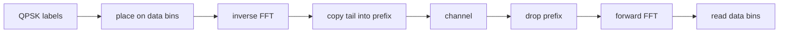

# Waveforms

## Constellations

BPSK puts bit 0 at `+1` and bit 1 at `-1`, which is the same sign convention
as the ideal trial. Gray QPSK is two rails. 8-PSK uses a Gray index around
the circle. Square 16-QAM and 64-QAM Gray-label each rail and scale the
average energy to 1. Soft bits are max-log LLRs from an enumeration of the
points. Positive means zero is closer.

## Pulses

`rrcTaps` builds a unit-energy square-root raised cosine. The matched filter
is the reversed taps. The total delay is one less than the tap length.
`quartz run` on `examples/qpsk_clean.qz` is the silent check: every label
comes back.

## OFDM

The inverse FFT divides by the length. The receiver FFT does not. A clean
loopback therefore returns the bins. A flat complex gain scales every data
bin. The cyclic prefix is a copy of the tail, so a one-tap channel is a
multiply per bin.

The 64-point, 16-sample prefix preset occupies the 52 tones from -26 to 26
excluding DC. Pilots are not separated in that preset. It is a Wi-Fi-shaped
symbol, not a claim that a commercial decoder will accept the frame.

## FSK, differential PSK, MSK

Binary FSK correlates a symbol against two tones an integer number of cycles
apart and picks the larger energy. Differential BPSK and QPSK encode phase
steps, so a common rotation of the burst does not change the bits. MSK
advances the phase by a quarter turn per symbol. The demodulator reads the
phase step between symbol boundaries. Gaussian MSK filters the frequency
steps with a binomial kernel of unit sum before the phase accumulator. The
envelope stays on the unit circle.

## MIMO

Alamouti sends two symbols from two antennas over two periods. The combiner
multiplies the originals by `|h1|^2 + |h2|^2` when the noise is zero.

Zero forcing inverts a square channel with LU. MMSE solves
`(H^H H + sigma^2 I) x = H^H y` with Cholesky. With no noise the two
estimates match the transmitted vector.

The sphere decoder searches BPSK vectors in the QR form of the channel and
agrees with exhaustive maximum likelihood on random 2 by 2 draws.

## Synchronization

Preamble search is a sliding correlation. A delayed copy peaks at that delay.
The phase-locked loop's error is the imaginary part of the derotated sample.
Started on the right frequency with a phase offset, the derotated sample
returns to the positive real axis.

## Pictures and sound

`quartz.io.png` writes an uncompressed PNG and can read that same subset
back, including the CRC on each chunk. `scatterPng` drops constellation
points onto a dark field. `quartz.io.wav` writes 16-bit mono PCM and reads
the rate and the samples back. The command line writes a JSON receipt. It
does not write a picture unless a caller asks the library to.
